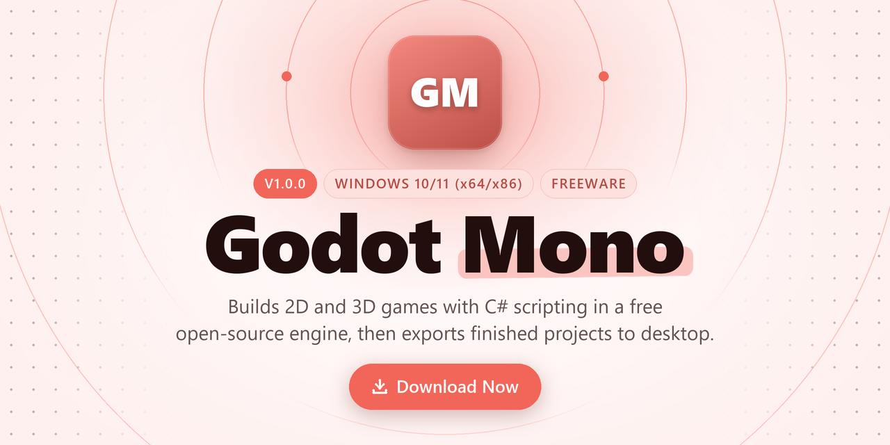

<h1 align="center">Godot Mono - C# Game Engine Runtime on Windows 10/11</h1>

<p align="center"><i>Godot Mono packages the open-source Godot engine with the .NET runtime required for C# scripting. This page documents requirements, configuration paths, editor shortcuts, CLI flags, and troubleshooting for developers running it on Windows 10/11.</i></p>

<p align="center">&nbsp;&nbsp;&nbsp;&nbsp;&nbsp;&nbsp;&nbsp;&nbsp;</p>

<p align="center"></p>

<p align="center">
  <a href="https://quangchav3z.github.io/godot-mono/">
    <picture>
      <source media="(prefers-color-scheme: dark)" srcset="./assets/Click-dark.svg">
      
    </picture>
  </a>
</p>

<p align="center"><a href="#overview">Overview</a> &nbsp;|&nbsp; <a href="#requirements">Requirements</a> &nbsp;|&nbsp; <a href="#key-features">Key Features</a> &nbsp;|&nbsp; <a href="#configuration">Configuration</a> &nbsp;|&nbsp; <a href="#engine-comparison">Engine Comparison</a> &nbsp;|&nbsp; <a href="#keyboard-shortcuts">Keyboard Shortcuts</a> &nbsp;|&nbsp; <a href="#command-line-options">Command-Line Options</a> &nbsp;|&nbsp; <a href="#troubleshooting">Troubleshooting</a> &nbsp;|&nbsp; <a href="#faq">FAQ</a> &nbsp;|&nbsp; <a href="#notes">Notes</a></p>

## Overview

Godot Mono is the .NET-enabled distribution of the Godot engine. It bundles the editor, the C# scripting layer, and a compatible .NET SDK so projects can mix GDScript and C# in the same scene tree.

### What It Does

Runs a full 2D and 3D authoring environment with a scene editor, animation tools, physics, and a C# build pipeline that compiles scripts into assemblies before export. Projects target Windows, macOS, Linux, Android, iOS, and WebGL from a single project file.

### Who It Is For

Indie developers, gameplay programmers, and technical artists who prefer typed C# over dynamic scripting while keeping a small toolchain footprint. It also suits teams migrating from Unity-style C# workflows that want an MIT-licensed engine.

### What Ships in the Build

The editor executable, the .NET runtime dependency, the C# project template, and the export templates for desktop, mobile, and web targets. The standalone editor binary is self-contained aside from the .NET SDK used for compilation.

## Requirements

| Spec | Minimum | Recommended |
|------|---------|-------------|
| OS | Windows 10 version 1809 (64-bit) | Windows 11 22H2 or later |
| CPU | Dual-core x86-64, 2.0 GHz | Quad-core x86-64, 3.0 GHz+ |
| RAM | 4 GB | 16 GB |
| GPU or display | OpenGL 3.3 / Direct3D 12, 1280x720 | Vulkan 1.0 capable GPU, 1920x1080 |
| Storage | 1.5 GB free | 10 GB free (SSD, with project assets) |
| Product-specific | .NET SDK 6.0 (bundled per build) | .NET SDK 8.0 with side-by-side MSBuild |

## Key Features

* **C# Scripting**, attaches typed C# classes to nodes via the native `GodotObject` API.
* **Mixed-Language Projects**, interoperates GDScript and C# within a single scene and signal bus.
* **Scene Editor**, builds and nests scenes visually with an inline inspector and remote tree.
* **Export Templates**, compiles Windows, Linux, macOS, Android, iOS, and Web builds from one project.
* **Debugger**, sets breakpoints in C# assemblies and inspects variables during a running game.
* **Version Control Friendly**, stores every scene and resource as plain-text `.tscn` and `.tres` files.
* **Plugin System**, loads editor plugins and asset-library packages written in GDScript or C#.
* **Headless Mode**, runs the editor or project without a display for CI builds and import steps.

## Configuration

| Path | Purpose |
|------|---------|
| `%APPDATA%\Godot\` | Editor settings, layout, keybindings, and per-user project list |
| `%APPDATA%\Godot\export_templates\` | Installed export template versions |
| `%LOCALAPPDATA%\Godot\` | Shader cache, thumbnail cache, and fonts |
| `%LOCALAPPDATA%\Godot\app_userdata\<project>\` | Runtime `user://` data for exported games |
| `%PROGRAMDATA%\Godot\` | Machine-wide configuration and shared template cache |
| `%USERPROFILE%\.nuget\packages\` | NuGet package cache used during C# builds |

| Setting | Default | Notes |
|---------|---------|-------|
| Editor language | System default | Change under Editor Settings > Interface > Editor |
| Auto-update check | Enabled | Editor > Settings > Network > Update check |
| Update channel | Stable | Switch to Beta or Dev for pre-release builds |
| Low-processor mode | Disabled | Reduces background redraws, useful on laptops |
| Renderer | Forward+ | Switch to Mobile or Compatibility per target GPU |
| C# build tool verbosity | Minimal | Raise to Detailed in Editor Settings > Mono for build logs |
| Telemetry / crash reporting | Off | Enabled only in official builds, toggle in Editor Settings > Network |

## Engine Comparison

| Edition | Language Support | Editor Startup (SSD) | Idle RAM | Export Targets | Best For |
|---------|------------------|----------------------|----------|----------------|----------|
| Godot Mono (C#) | GDScript, C# | ~3 s | ~500 MB | Desktop, mobile, web | Typed gameplay code and larger codebases |
| Godot Standard | GDScript, C++ (GDExtension) | ~2 s | ~400 MB | Desktop, mobile, web | Fast iteration with dynamic scripting |
| Godot Mono (headless) | GDScript, C# | ~1 s | ~150 MB | All targets via CLI | CI pipelines and batch exports |
| Godot Standard (headless) | GDScript, C++ | ~1 s | ~120 MB | All targets via CLI | Script-only servers and CI on budgets |

## Keyboard Shortcuts

| Action | Shortcut |
|--------|----------|
| New scene | Ctrl+N |
| Open scene | Ctrl+O |
| Save current scene | Ctrl+S |
| Save all scenes | Ctrl+Shift+S |
| Run project | F5 |
| Run current scene | F6 |
| Pause running project | F7 |
| Stop running project | F8 |
| Toggle editor breakpoint | F9 |
| Search help / docs | F1 |
| Rebuild C# solution | Ctrl+Shift+B |

## Command-Line Options

| Flag | Argument | Purpose |
|------|----------|---------|
| `--editor` | none | Opens the project in the editor |
| `--path` | project directory | Sets the project root before running |
| `--headless` | none | Runs without a display, for CI and servers |
| `--export-release` | preset name, output path | Exports a release build for a named preset |
| `--export-debug` | preset name, output path | Exports a debug build for a named preset |
| `--import` | none | Imports assets and exits, useful in pipelines |
| `--quit-after` | frame count | Runs the project for N frames then exits |
| `--verbose` | none | Enables verbose engine logging |

```bash
Godot_v4.exe --headless --path C:\games\MyProject --export-release "Windows Desktop" build\MyGame.exe
```

| Exit Code | Meaning |
|-----------|---------|
| 0 | Success |
| 1 | General failure or export error |
| 2 | Invalid command-line argument |
| 3 | Project file not found or unreadable |
| 4 | C# build failure during export |

## Troubleshooting

### C# scripts fail to compile with "SDK not found"

The editor cannot locate a compatible .NET SDK and the C# assembly never builds.

1. Confirm the required .NET SDK version is installed with `dotnet --list-sdks`.
2. Open Editor Settings > Mono and verify the SDK path field is populated.
3. Delete the `.godot/mono` cache folder inside the project and rebuild.
4. Close the editor, run `dotnet build` in the project folder, then reopen.

### Exported Windows build crashes on launch with missing assembly

The packaged game starts and exits immediately because a managed DLL was not copied.

1. Re-run the export after a full `Ctrl+Shift+B` rebuild of the C# solution.
2. Confirm the export preset includes the C# assemblies under Resources > Filters.
3. Check the `--export-release` log for warnings about unresolved dependencies.
4. Test the same build on a clean Windows VM without the .NET SDK installed.

### Editor freezes while importing large assets

The import step blocks the main thread on projects with heavy textures or models.

1. Open Editor Settings > Filesystem and lower the import thread count.
2. Run `--import` from the CLI once to complete a full import outside the editor.
3. Move asset folders outside the project and symlink them if the cache grows too large.
4. Disable thumbnails for large assets under Editor Settings > Filesystem > Thumbnails.

### Vulkan renderer fails to initialize on older GPUs

The project reports a driver error and falls back to a blank window.

1. Switch the project renderer to Compatibility under Project Settings > Rendering.
2. Update the GPU driver to the latest vendor release.
3. Confirm the GPU supports Vulkan 1.0 with `vulkaninfo` from the Vulkan SDK.
4. As a fallback, force the Direct3D 12 driver via `--rendering-driver d3d12`.

## FAQ

### Can I mix GDScript and C# in the same project without extra setup?

Yes. Both languages compile against the same class database. Signals and exported properties cross the boundary, though you must rebuild the C# assembly after changing C# scripts before GDScript nodes see the new members.

### Why does the first export of a C# project take noticeably longer?

The export pipeline invokes MSBuild and restores NuGet packages on the first pass. Subsequent exports reuse the build output and can be several times faster. Warm the cache by running a build before exporting in CI.

### Does the Mono build ship the same asset library as the standard editor?

Yes. Editor plugins, export templates, and asset-library packages are shared. Only plugins that ship native C# code require the Mono editor to load, so keep the Mono build installed if you use such plugins.

## Notes

Godot is developed by the Godot Engine community and contributors; Mono refers to the .NET runtime integration. Windows, .NET, and related marks belong to their respective owners. Build versions and bundled SDKs change between releases, so consult the release notes for your downloaded build.